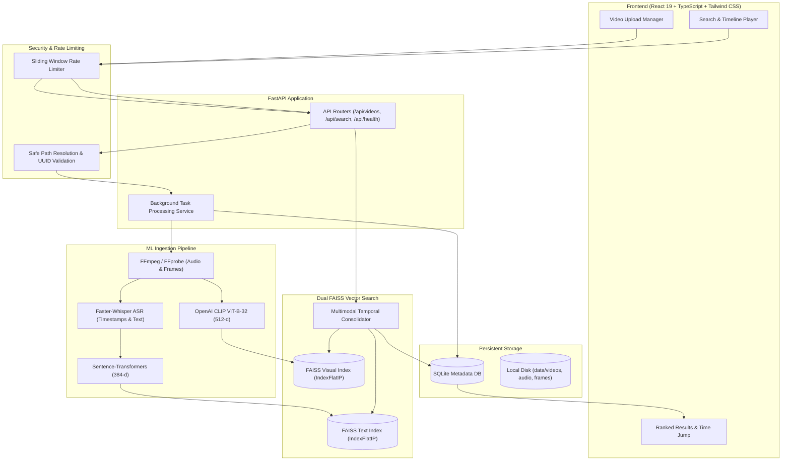

# Semantic Video Retrieval Using Deep Learning

> **A full-stack, multimodal deep learning system for searching, indexing, and retrieving relevant moments from long-form videos using natural-language queries with synchronized timeline playback.**

[](#status)
[](https://fastapi.tiangolo.com/)
[](https://react.dev/)
[](https://huggingface.co/)
[](https://github.com/facebookresearch/faiss)
[](https://github.com/SYSTRAN/faster-whisper)

---

## 1. System Overview & Architecture

**Semantic Video Retrieval** indexes spoken dialogue and visual scene keyframes from videos into dual dense vector search spaces, enabling sub-80ms semantic retrieval over hours of video footage.

### Core Capabilities:
- **Speech Dialogue Semantic Search**: Transcribes speech using Faster-Whisper with word-level timestamps and indexes cohesive speech chunks using Sentence-Transformers (`all-MiniLM-L6-v2`, 384-d).
- **Visual Scene Cross-Modal Search**: Samples visual keyframes at configurable temporal intervals (default: 2.0s) and computes cross-modal embeddings using OpenAI CLIP (`ViT-B-32`, 512-d).
- **Temporal Consolidator & Multimodal Fusion**: Consolidates speech and visual evidence within matching temporal windows using either **Calibrated Linear Fusion** ($\alpha \cdot \text{text} + \beta \cdot \text{visual}$) or **Reciprocal Rank Fusion (RRF)**.
- **Synchronized Video Player**: Custom HTML5 video player with RFC 7233 byte-range seeking that instantly jumps to exact timestamp coordinates upon clicking search results.
- **Security & Reliability**: Thread-safe sliding window rate limiting, path traversal protection, UUID validation, and offline-capable mock ML test suites.



---

## 2. Technology Stack

| Layer | Component | Specification |
|---|---|---|
| **Frontend** | React 19, TypeScript, Vite, Tailwind CSS, Lucide Icons | Responsive modern UI with direct timeline seeking, live progress bars, and confidence badges |
| **Backend** | FastAPI, Uvicorn, Python 3.12 | RESTful API with Pydantic v2 validation, background workers, and structured logging |
| **Metadata DB** | SQLite, SQLAlchemy ORM | ACID-compliant storage for videos, jobs, transcript segments, and frame metadata |
| **Vector Engine** | FAISS (`IndexFlatIP`) | High-performance in-memory inner product vector search with disk persistence |
| **Speech ASR** | Faster-Whisper (`base` / `int8`) | CTranslate2-accelerated automatic speech recognition with word-level timestamps |
| **Text Embedder** | Sentence-Transformers (`all-MiniLM-L6-v2`) | 384-dimensional dense semantic sentence representations |
| **Vision Embedder**| OpenAI CLIP (`ViT-B-32` / `clip-vit-base-patch32`) | 512-dimensional joint image-text vision embeddings |
| **Media Toolkit** | FFmpeg, FFprobe, OpenCV | Audio extraction (16kHz mono WAV), scene frame extraction, and RFC 7233 streaming |

---

## 3. Quick Start Guide

### Prerequisites
- **Operating System**: Windows 11 / Linux / macOS
- **Python**: 3.10+ (tested on Python 3.12.10)
- **Node.js**: 18+ (tested with npm)
- **FFmpeg**: Installed and accessible on your system `PATH` (or configured via environment)

---

### Step 1: Clone and Set Up Python Environment
```powershell
# Clone the repository
git clone https://github.com/your-username/semantic-video-retrieval.git
cd semantic-video-retrieval

# Create and activate Python virtual environment
python -m venv .venv
.\.venv\Scripts\activate   # On Windows
# source .venv/bin/activate  # On Linux / macOS

# Install backend dependencies
pip install -r backend/requirements.txt
```

### Step 2: Configure Environment Variables
```powershell
# Copy the example environment template
cp .env.example .env
```
*(The defaults in `.env` are configured for local execution out-of-the-box).*

### Step 3: Install Frontend Dependencies
```powershell
cd frontend
npm install
cd ..
```

---

### Step 4: Run the Application

#### Start Backend Server:
```powershell
.\.venv\Scripts\uvicorn backend.app.main:app --host 127.0.0.1 --port 8000
```
- API Documentation (Swagger UI): `http://127.0.0.1:8000/docs`
- Health Check: `http://127.0.0.1:8000/api/health`

#### Start Frontend Client:
```powershell
npm --prefix frontend run dev
```
- Web Application UI: `http://127.0.0.1:5173`

---

## 4. Search Modalities

1. **Dialogue Search (`modality="text"`)**:
   - Matches queries against spoken dialogue transcripts.
   - *Example*: `"Where does the speaker explain gradient descent?"`
2. **Visual Search (`modality="visual"`)**:
   - Matches queries directly against visual frames and scene entities using CLIP.
   - *Example*: `"Show the moment when a red car appears."`
3. **Multimodal Fused Search (`modality="multimodal"`)**:
   - Merges dialogue and visual keyframe candidates occurring within a temporal context window (default: 10s).
   - Supports **Balanced Linear Fusion** ($\alpha=0.5, \beta=0.5$) with score calibration and **Reciprocal Rank Fusion (RRF)**.
   - *Example*: `"Speaker discussing global warming with ocean water visual."`

---

## 5. Security & Reliability Controls

- **Path Traversal Protection**: All disk access validates that file paths resolve strictly inside authorized data storage directories (`data/videos`, `data/frames`, `data/audio`). Malicious relative path escapes (`../../`) trigger HTTP 403 / 422.
- **Sliding-Window Rate Limiting**: In-memory rate limiting prevents denial-of-service on search (60 req/min) and upload (15 req/min) with standard `Retry-After` headers.
- **RFC 7233 Media Streaming**: Video streaming endpoints support HTTP Partial Content (206) with byte-range parsing for video seeking, appending `X-Content-Type-Options: nosniff` and `X-Frame-Options: SAMEORIGIN`.
- **Offline-Capable Mock ML Tests**: In addition to end-to-end integration tests, offline mock test suites (`test_mock_ml_offline.py`) permit headless execution in CI environments without external model downloads or GPU hardware.

---

## 6. Reproducible Benchmark Evaluation

The system includes a fully reproducible evaluation framework that executes 6 retrieval configurations across a version-controlled ground-truth dataset (`evaluation/data/benchmark_dataset.json`):

```powershell
# Run the complete automated evaluation suite
.\.venv\Scripts\python -m evaluation.run_benchmark
```

### Measured Performance Summary (from `docs/EVALUATION_REPORT.md`):
| Configuration | Recall@1 | Recall@5 | Precision@1 | MRR | Mean Latency | Rejection P@1 (Threshold >= 0.25) |
|---|:---:|:---:|:---:|:---:|:---:|:---:|
| **Text-Only (`all-MiniLM-L6-v2`)** | 0.600 | 0.600 | 0.600 | 0.600 | **16.9 ms** | **1.000 (3/3 rejected)** |
| **Visual-Only (`CLIP ViT-B-32`)** | 0.400 | 0.533 | 0.400 | 0.439 | 31.2 ms | **1.000 (3/3 rejected)** |
| **Multimodal Balanced (50/50 Linear)** | 0.600 | 0.733 | 0.600 | 0.656 | 43.2 ms | **1.000 (3/3 rejected)** |
| **Multimodal Dialogue-Focused (70/30)**| **0.667** | 0.733 | **0.667** | **0.689** | 40.5 ms | **1.000 (3/3 rejected)** |
| **Multimodal Reciprocal Rank Fusion (RRF)**| 0.600 | **0.800** | 0.600 | 0.663 | 43.6 ms | **1.000 (3/3 rejected)** |

*For complete ablation tables, hardware disclosures, and per-query predictions, see [`docs/EVALUATION_REPORT.md`](docs/EVALUATION_REPORT.md).*

---

## 7. Running Tests

```powershell
# Run all backend unit, integration, security, and offline mock tests
.\.venv\Scripts\pytest -v

# Run frontend production build check
npm --prefix frontend run build
```

---

## 8. Project Structure

```text
semantic-video-retrieval/
├── backend/
│   ├── app/
│   │   ├── api/             # Modular API routes (videos, search, frames, transcripts)
│   │   ├── core/            # Configuration, logging, security, rate limiting, exceptions
│   │   ├── db/              # SQLAlchemy session and schema migrations
│   │   ├── ml/              # Faster-Whisper, Sentence-Transformers, CLIP, FAISS index
│   │   ├── models/          # Video, ProcessingJob, TranscriptSegment, VisualFrame ORM
│   │   ├── schemas/         # Pydantic v2 schemas and validators
│   │   ├── services/        # Audio, video, chunking, search, temporal consolidation
│   │   └── main.py          # FastAPI application factory and lifespan manager
│   ├── tests/               # 40 comprehensive unit, integration, and mock ML tests
│   └── requirements.txt     # Backend Python dependencies
├── frontend/
│   ├── src/
│   │   ├── api/             # Typed API client
│   │   ├── components/      # VideoPlayer, SearchBar, ResultCard, UploadModal
│   │   ├── pages/           # SearchPage, VideosPage
│   │   └── types/           # TypeScript API interfaces
│   └── package.json         # Frontend Node.js dependencies
├── data/                    # Local storage (gitignored except .gitkeep)
│   ├── videos/              # Stored uploaded video files
│   ├── audio/               # Extracted 16kHz mono WAV files
│   ├── frames/              # Sampled visual keyframe JPEGs
│   └── indexes/             # FAISS index files and ID maps
├── evaluation/              # Phase 7 & 8 evaluation benchmarking harness
│   ├── data/                # Ground-truth dataset schema and benchmark annotations
│   ├── results/             # Machine-readable evaluation JSON output
│   ├── benchmark_generator.py # Automated corpus generator and indexer
│   ├── evaluator.py         # Multi-configuration retrieval evaluation engine
│   └── run_benchmark.py     # Single-command CLI evaluation runner
├── docs/
│   ├── API_CONTRACTS.md     # Full OpenAPI contract specification
│   ├── ARCHITECTURE.md      # Detailed system architecture and sequence flows
│   ├── DATABASE_SCHEMA.md   # SQLite schema and entity relationship diagrams
│   ├── DEVELOPMENT_ROADMAP.md # Phase-by-phase implementation checklist
│   └── EVALUATION_REPORT.md # Formal empirical evaluation and ablation study report
├── .env.example             # Configuration template
└── README.md                # Project documentation
```

---

## 9. Status & Roadmap

| Phase | Milestone | Status |
|---|---|:---:|
| **Phase 0** | Requirements, Architecture, and Planning | `VERIFIED` |
| **Phase 1** | Project Scaffolding & Application Foundation | `VERIFIED` |
| **Phase 2** | Video Upload, Validation, and Preprocessing | `VERIFIED` |
| **Phase 3** | Timestamped Transcription & Text Indexing | `VERIFIED` |
| **Phase 4** | Semantic Search MVP & Frontend Integration | `VERIFIED` |
| **Phase 5** | Visual Content Retrieval (OpenAI CLIP ViT-B-32) | `VERIFIED` |
| **Phase 6** | Multimodal Fusion & Temporal Context Consolidation | `VERIFIED` |
| **Phase 7** | Evaluation, Benchmarking & Bottleneck Optimization | `VERIFIED` |
| **Phase 8** | Reliability, Security, Documentation & Final Demo | `VERIFIED` |

---

## 10. License

This academic project is licensed under the MIT License.
