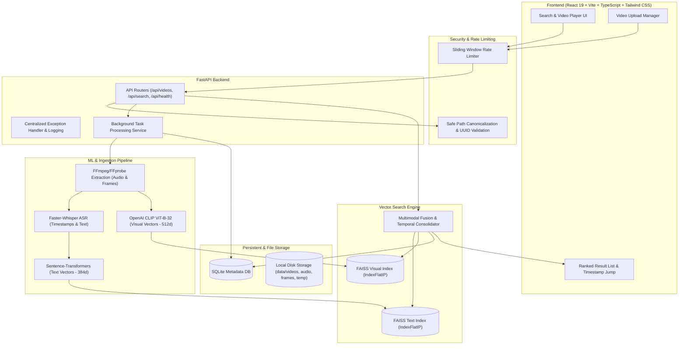

# Architecture Specification: Semantic Video Retrieval

## 1. System Overview

**Semantic Video Retrieval** is a full-stack, multimodal deep learning web application that enables natural-language search over long-form videos. The system extracts speech and visual semantics, indexes them into vector search spaces, and provides instant playback at exact timestamps matching user queries.

---

## 2. Core Architectural Principles

1. **Strict Separation of Concerns**:
   - Web server (FastAPI) handles request validation, orchestration, and query dispatch.
   - Long-running ingestion jobs run strictly asynchronously outside HTTP request cycles.
   - Database (SQLite) remains the ground truth for metadata, video properties, and segment timings.
   - Vector indexes (FAISS) are derived artifacts mapped 1:1 to SQLite entity IDs.
2. **Absolute Timestamp Coordinates**:
   - All timestamps (`start_time`, `end_time`, frame timestamps) represent absolute floating-point seconds relative to the original video timeline (`0.0` to `video.duration`).
   - Seeking in the video player operates directly on these coordinates without offsets.
3. **Reproducibility and Modularity**:
   - Vector stores implement normalized cosine similarity (`IndexFlatIP`), allowing plug-and-play transitions between FAISS, Qdrant, or Chroma.
   - Embedding models are isolated behind model service abstractions with configurable model weights, devices (`cuda` / `cpu`), and quantization types (`float32`, `int8`).
4. **Resilient Local Development**:
   - Fully local execution without external paid APIs or cloud vendor locks.
   - Graceful fallback: CUDA GPU when present, clean CPU execution when absent.

---

## 3. Component Architecture

### 3.1 Backend Application (`backend/app`)
- **`core/`**:
  - `config.py`: Environment-driven settings with Pydantic Settings.
  - `exceptions.py`: Centralized domain exceptions (`SecurityError`, `RateLimitExceededError`, `VideoNotFoundError`, `ValidationError`).
  - `security.py`: Safe path resolution (`safe_resolve_path`), filename sanitization (`sanitize_filename`), and UUID validation (`validate_uuid`).
  - `rate_limiter.py`: Thread-safe sliding window in-memory rate limiter.
  - `logging.py`: Structured console logging.
- **`db/`**: SQLite connection, SQLAlchemy ORM session management, schema initialization.
- **`models/`**: SQLAlchemy ORM models (`Video`, `ProcessingJob`, `TranscriptSegment`, `VisualFrame`).
- **`schemas/`**: Pydantic v2 schemas for request validation and typed API responses.
- **`api/`**: Modular APIRouters (`health.py`, `videos.py`, `frames.py`, `transcripts.py`, `search.py`).
- **`services/`**:
  - `video_service.py`: Video file validation, storage, metadata extraction using FFprobe.
  - `audio_service.py`: Audio extraction to 16kHz mono WAV via FFmpeg.
  - `job_service.py`: Background job state transitions and thread-safe queue.
  - `chunking_service.py`: Cohesive transcript chunking with timestamp preservation.
  - `temporal_consolidator.py`: Cross-modal temporal evidence pairing, frame deduplication, linear score fusion, and RRF.
  - `stream_service.py`: RFC 7233 compliant partial content HTTP streaming with range validation and security headers.
  - `search_service.py`: Query embedding, FAISS search, result ranking, and multimodal fusion orchestration.
- **`ml/`**:
  - `transcription.py`: Faster-Whisper wrapper with segment and word timing extraction.
  - `text_embeddings.py`: Sentence-Transformers (`all-MiniLM-L6-v2`) embedder (384-d).
  - `visual_embeddings.py`: OpenAI CLIP (`openai/clip-vit-base-patch32`) frame embedder (512-d).
  - `vector_index.py`: FAISS vector index manager with atomic persistence and ID mapping.

### 3.2 Frontend Application (`frontend/src`)
- **`api/`**: Typed Axios/Fetch client with backend API bindings and error handling.
- **`types/`**: TypeScript interfaces mirroring Pydantic backend models.
- **`components/`**:
  - `VideoPlayer`: Custom HTML5 video player with programmatic seek, time-synchronization, and segment bounding.
  - `SearchBar`: Query input with mode selector (Text, Visual, Multimodal), threshold slider, and top-k controls.
  - `ResultCard`: Formatted snippet display showing timestamp badges, relevance scores, and jump buttons.
  - `UploadModal`: Drag-and-drop file upload with live progress tracking and stage updates.
  - `StatusBadge`: Visual indicator of video processing states.
- **`pages/`**:
  - `SearchPage`: Unified search interface and interactive video player.
  - `VideosPage`: Video catalog, upload manager, and pipeline inspection.

---

## 4. Hardware and Computational Profile

- **Operating System**: Windows 11 (PowerShell environment)
- **CPU**: 12th Gen Intel(R) Core(TM) i5-12450H (8 physical cores, 12 logical processors, x86_64 architecture)
- **GPU**: NVIDIA GeForce RTX 3050 Laptop GPU (6GB GDDR6 VRAM, CUDA 12.8 compatible)
- **Model Selections**:
  - ASR: Faster-Whisper `base` (`int8` compute type; RAM footprint ~350 MB)
  - Text Embeddings: `all-MiniLM-L6-v2` (384 dimensions; RAM footprint ~120 MB)
  - Visual Embeddings: `openai/clip-vit-base-patch32` (512 dimensions; RAM footprint ~600 MB)
  - Dual FAISS Indexes: In-memory `IndexFlatIP` with disk serialization.

---

## 5. Security, Reliability, and Streaming Guarantees

1. **Path Traversal Prevention**:
   - All file lookups (video streaming, frame JPEG rendering, disk deletion) pass through `safe_resolve_path()`, guaranteeing paths are strictly contained within their designated data directories.
2. **Input Sanitization & Validation**:
   - Uploaded filenames are stripped of directory components and dangerous characters.
   - All path parameters and IDs are validated against strict UUID formats before querying the database.
   - Search requests strip queries and reject whitespace-only submissions.
3. **Sliding Window Rate Limiting**:
   - In-memory thread-safe rate limiter tracks client requests across customizable tiers (`upload`, `search`, `default`). Exceeded limits return HTTP 429 with standard `Retry-After` headers.
4. **RFC 7233 Media Streaming**:
   - Video streaming supports byte-range requests (`bytes=start-end`), enabling scrubbing and instant playback seeking. Out-of-bounds ranges return HTTP 416 Range Not Satisfiable.
   - Security response headers (`X-Content-Type-Options: nosniff`, `X-Frame-Options: SAMEORIGIN`) are appended to all media streams.
5. **Offline Mock Testing**:
   - Comprehensive test suite provides mock-based offline tests allowing full CI execution without external network calls or GPU dependencies.
