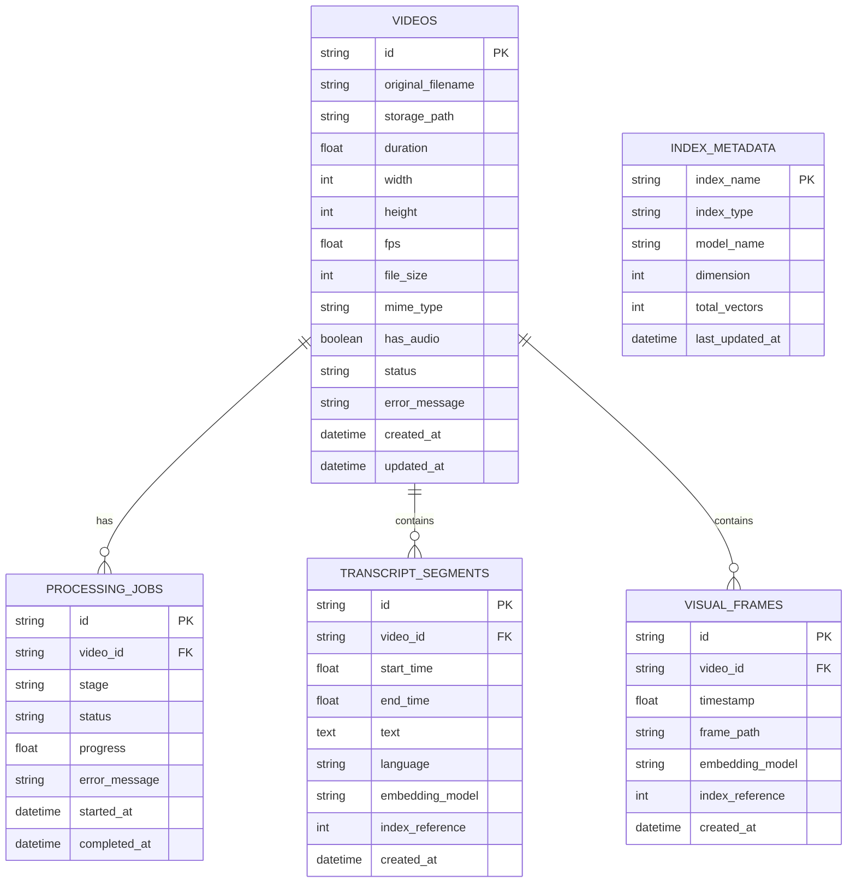

# Database Schema Proposal: Semantic Video Retrieval

## 1. Storage Overview

The primary metadata database is **SQLite** (`data/metadata.db`), managed via **SQLAlchemy**. SQLite is the authoritative source of truth for:
- Video records, file locations, and media properties.
- Ingestion jobs and progress logs.
- Transcript chunks with exact start/end seconds.
- Sampled visual frames with exact video timestamps.
- Metadata synchronizing vector store indices to relational entities.

---

## 2. Table Definitions

### 2.1 `videos`
Stores high-level metadata for every uploaded video file.

| Column | Type | Nullable | Description |
|---|---|---|---|
| `id` | VARCHAR(36) | NO | Primary Key (UUIDv4) |
| `original_filename` | VARCHAR(255) | NO | Sanitized original filename supplied during upload |
| `storage_path` | VARCHAR(512) | NO | Internal relative path (`data/videos/{id}.mp4`) |
| `duration` | FLOAT | YES | Duration in seconds extracted via FFprobe |
| `width` | INTEGER | YES | Frame width in pixels |
| `height` | INTEGER | YES | Frame height in pixels |
| `fps` | FLOAT | YES | Video frames per second |
| `file_size` | BIGINT | NO | Video size in bytes |
| `mime_type` | VARCHAR(100) | NO | Detected MIME media type |
| `has_audio` | BOOLEAN | NO | True if audio stream was detected, else False |
| `status` | VARCHAR(50) | NO | Ingestion status (`UPLOADED`, `PROCESSING`, `READY`, `FAILED`) |
| `error_message` | TEXT | YES | Detailed failure reason if ingestion failed |
| `created_at` | DATETIME | NO | Creation timestamp (UTC) |
| `updated_at` | DATETIME | NO | Last modification timestamp (UTC) |

### 2.2 `processing_jobs`
Tracks progress and operational stages of ingestion pipelines.

| Column | Type | Nullable | Description |
|---|---|---|---|
| `id` | VARCHAR(36) | NO | Primary Key (UUIDv4) |
| `video_id` | VARCHAR(36) | NO | Foreign Key -> `videos.id` (ON DELETE CASCADE) |
| `stage` | VARCHAR(50) | NO | Current pipeline stage (`VALIDATING`, `EXTRACTING_AUDIO`, `TRANSCRIBING`, `EMBEDDING`, `INDEXING`, `SAMPLING_FRAMES`) |
| `status` | VARCHAR(50) | NO | Job status (`PENDING`, `RUNNING`, `COMPLETED`, `FAILED`) |
| `progress` | FLOAT | NO | Progress percentage (0.0 to 100.0) |
| `error_message` | TEXT | YES | Stage-specific error or stack trace |
| `started_at` | DATETIME | NO | Job start time (UTC) |
| `completed_at` | DATETIME | YES | Job completion time (UTC) |

### 2.3 `transcript_segments`
Maintains discrete timestamped speech chunks used for semantic text search.

| Column | Type | Nullable | Description |
|---|---|---|---|
| `id` | VARCHAR(36) | NO | Primary Key (UUIDv4) |
| `video_id` | VARCHAR(36) | NO | Foreign Key -> `videos.id` (ON DELETE CASCADE) |
| `start_time` | FLOAT | NO | Absolute start time in seconds (relative to video origin) |
| `end_time` | FLOAT | NO | Absolute end time in seconds (relative to video origin) |
| `text` | TEXT | NO | Transcribed speech content |
| `language` | VARCHAR(10) | YES | Detected ISO language code (e.g., `en`, `es`) |
| `embedding_model` | VARCHAR(100) | YES | Model used to generate vector (e.g. `all-MiniLM-L6-v2`) |
| `index_reference` | INTEGER | YES | Sequential integer ID assigned in the FAISS index |
| `created_at` | DATETIME | NO | Creation timestamp (UTC) |

### 2.4 `visual_frames`
Maintains sampled video frames and their visual vector references.

| Column | Type | Nullable | Description |
|---|---|---|---|
| `id` | VARCHAR(36) | NO | Primary Key (UUIDv4) |
| `video_id` | VARCHAR(36) | NO | Foreign Key -> `videos.id` (ON DELETE CASCADE) |
| `timestamp` | FLOAT | NO | Exact timestamp of the sampled frame in seconds |
| `frame_path` | VARCHAR(512) | YES | Path to cached thumbnail/preview if retained |
| `embedding_model` | VARCHAR(100) | YES | Vision model identifier (e.g. `ViT-B-32-laion2b`) |
| `index_reference` | INTEGER | YES | Sequential integer ID assigned in the visual FAISS index |
| `created_at` | DATETIME | NO | Creation timestamp (UTC) |

### 2.5 `index_metadata`
Ensures vector indexes and relational data stay synchronized across restarts.

| Column | Type | Nullable | Description |
|---|---|---|---|
| `index_name` | VARCHAR(50) | NO | Primary Key (`text_index` or `visual_index`) |
| `index_type` | VARCHAR(50) | NO | FAISS index type (e.g. `IndexFlatIP`) |
| `model_name` | VARCHAR(100) | NO | Pretrained model name associated with index |
| `dimension` | INTEGER | NO | Vector dimension (e.g. 384 for text, 512 for visual) |
| `total_vectors` | INTEGER | NO | Total vectors indexed |
| `last_updated_at` | DATETIME | NO | Last timestamp vectors were added |
